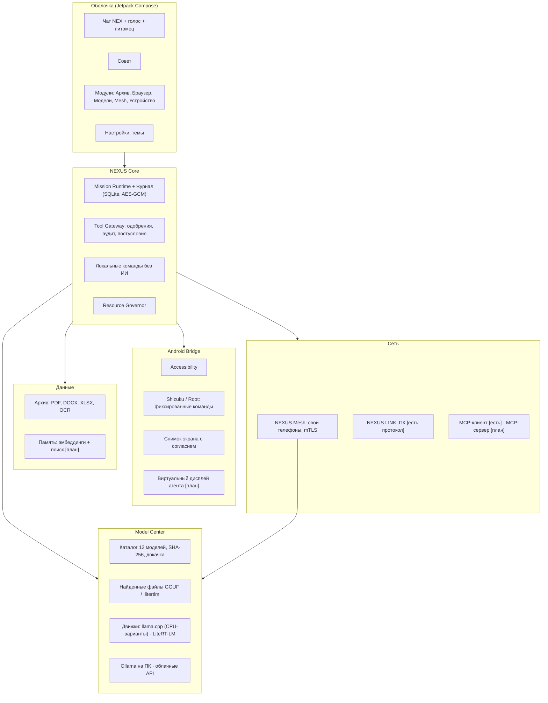

# Исследование 5 — целевая архитектура NEXUS

Архитектура строится от того, что уже есть в коде (статусы — в
[матрице реализации](../NEXUS_IMPLEMENTATION_MATRIX_RU.md)), и добавляет
лучшие идеи из исследованных проектов. Пометки: **[есть]** — реализовано,
**[план]** — следующий этап, **[идея]** — после проверки пользы.

## Слои



## Модули и происхождение идей

| Модуль | Состояние | Что взять из исследования |
|---|---|---|
| Чат, голос, NEX | [есть] | Офлайн-голос: whisper.cpp + Piper ru_RU (PocketPal, ServLlama, Local AI) [план] |
| Model Center | [есть]: каталог, SHA-256, докачка, найденные файлы, Ollama `/api/pull` | Профили ускорителей с откатом на CPU и бенчмарк pp/tg (AiPaca, PocketPal) [план] |
| Движки | [есть]: llama.cpp `v1.0.0` с CPU-вариантами, LiteRT-LM 0.16.1 | OpenCL Adreno для llama.cpp [план]; обновление LiteRT-LM [план] |
| Локальный API | [идея] | OpenAI-совместимый сервер на телефоне (AiPaca, ServLlama, PocketPal Plus) — чтобы другие приложения и ПК могли пользоваться моделью телефона |
| Mission Runtime + Council | [есть] | Распределение агентов совета по телефонам NEXUS Mesh [план, Mesh Phase 5] |
| Tool Gateway | [есть]: конвейер, одобрения, аудит | Политика «разрешить / спрашивать / запретить» для каждого инструмента (Operit) [план] |
| Android Bridge | [есть]: a11y, Shizuku, Root, снимок, настройки | Виртуальный дисплей агента (Mika, OpenCyvis, Phone-MCP); детекторы залипания и повторов (DroidClaw); передача капчи владельцу (Nyral) [план] |
| Браузер | [есть]: вкладки, история, политика адресов | Браузерный агент: чтение структуры, клики, ввод (Operit, Nyral, Mika) [план] |
| Архив | [есть]: PDF, DOCX, XLSX, OCR, цитаты | Локальный RAG: эмбеддинги (Qwen3-Embedding / EmbeddingGemma) + переранжирование (bge-reranker-v2-m3) (Local AI, Nyral) [план] |
| Linux-среда | нет | PRoot с Ubuntu/Alpine (Operit, Local AI, OpenMinis, Aether) — [идея]; большой объём и поверхность атаки, нужна явная польза |
| MCP | [есть]: клиент | MCP-сервер NEXUS поверх Mesh/LINK, чтобы ИИ на ПК давал задачи телефону (Zafiro, Mika, Phone-MCP) [план] |
| NEXUS Mesh | [есть]: фазы 1–2 | Фазы 3–6 — см. [архитектуру Mesh](../NEXUS_MESH_ARCHITECTURE_RU.md) |

## Поток запроса (как сейчас)

```
владелец → ChatController
  ├─ локальная команда? (время, калькулятор, будильник) → ответ телефона без ИИ
  ├─ Resource Governor: заряд / нагрев / память → отказ с причиной или «можно»
  ├─ ядро: llama.cpp | LiteRT-LM | Ollama на ПК | облако → поток токенов
  ├─ StreamSanitizer: служебные токены и <think> не попадают в ответ
  └─ журнал миссии + история чата (AES-GCM) → ответ в одном снимке состояния
```

## Принципы, подтверждённые исследованием

1. **Модель — исполнитель, NEXUS — контроль.** Все сильные агенты
   (Operit, Zafiro, Phone-MCP) держат одобрения и аудит вне модели.
2. **Свой ключ и свои данные.** Mika, Nyral, Zafiro не имеют своего сервера;
   NEXUS так же хранит ключи в Android Keystore и не отправляет данные без
   действия владельца.
3. **Готовый движок, свой продукт.** Ни одно сильное приложение не пишет
   инференс с нуля: llama.cpp / LiteRT-LM / MNN берутся как библиотеки.
4. **Честные статусы.** «Подключено», «распределено», «готово» показываются
   только по факту (как в NEXUS Mesh и Model Center).
